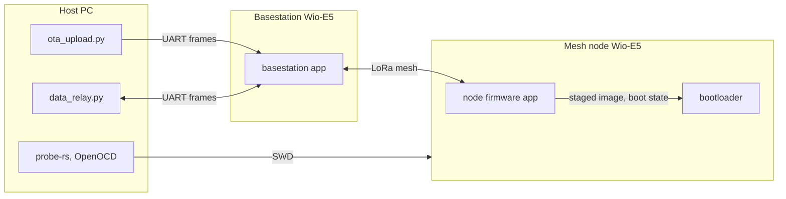
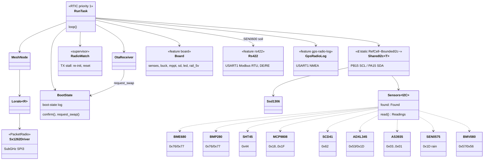
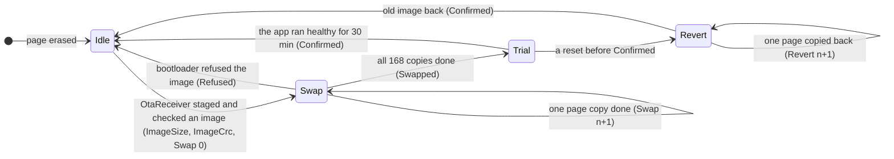
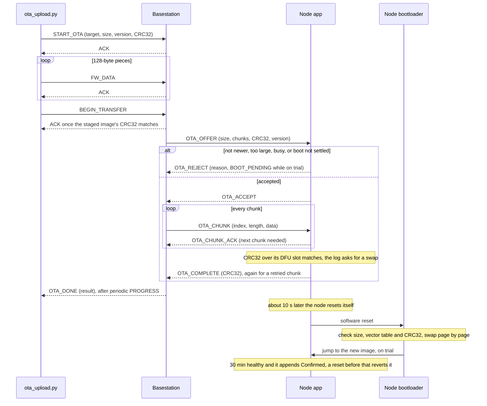
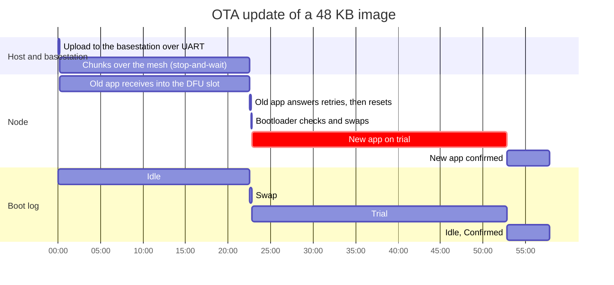
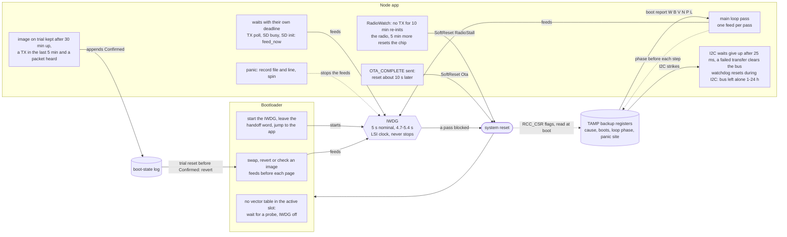

# Architecture

## System

Every Wio-E5 carries the bootloader in its first 16 KB and one app: the
mesh node firmware, or on one of them the basestation, which links the
mesh to a host PC. Host and basestation exchange framed commands over a
UART (`basestation/src/uart_proto.rs` and
`basestation/host/basestation_proto.py` implement the same frame format).
That UART is USART1 through a USB-UART adapter, or with the `board`
feature USART2 to the Forest Sensor Platform's CH572D, which bridges it to
USB-C and also serves as the SWD probe.

The partition map that the bootloader and the apps share is defined once
in [flash-layout/src/lib.rs](flash-layout/src/lib.rs), and each crate's
build script generates its linker `memory.x` from it. The boot-state log
between them, the slot swap and the image CRC live in the same crate
([flash-layout/src/boot.rs](flash-layout/src/boot.rs),
[flash-layout/src/crc32.rs](flash-layout/src/crc32.rs)).

## Node firmware

The radio driver implements a `PacketRadio` trait used by the mesh layer.
The driver manages RX/TX state - entering continuous RX on the first poll,
transitioning to standby before TX, then polling the IRQ register for
`TxDone` or `Timeout` rather than blocking on the DIO1 pin.

Everything below hangs off the single priority-1 RTIC task in
`firmware/src/bin/main.rs`; the cfg-gated blocks are cargo features. That
single priority is what makes `SharedI2c`'s `RefCell` sound.

The 0x1D three-way conflict between ADXL345, MCP9808 and SEN0575 is
resolved in probe order (notes/sensors.md, the SEN0575 section).

## Boot state

The bootloader reads the boot-state log on every boot, carries out what
it asks for, then jumps to the active slot. The log is an append-only
list of records, one per flash double-word; each change appends one, so a
power cut at any point leaves the last durable record in charge, and a
swap or revert resumes at the page copy it was in (notes/boot-ota.md,
"The boot-state log and the swap").

The record names are `flash_layout::boot::Record`. An image the
bootloader did not start (probe-rs sets the program counter itself)
settles whatever the log had pending at once, so the next boot cannot
revert over a freshly flashed build or copy pages over it.

## Over-the-air update

`mise run ota-upload` hands an image to the basestation, which stages it
in its own DFU slot and pushes it to the target node in 27-byte chunks,
stop-and-wait. The message layouts are in
`firmware/src/ota_protocol.rs` (mesh) and `basestation/src/uart_proto.rs`
(UART).

The same update over time, for a 48 KB image at the default `fast`
preset. All durations are estimates (notes/boot-ota.md, "OTA timing").

## Watchdogs

The independent watchdog (IWDG) resets the chip when the loop stops; the
rest of the system decides what a reset means and makes sure each one is
reported. `firmware/src/watchdog.rs` says who starts and feeds the IWDG,
`firmware/src/supervisor.rs` holds the health rules, and
`firmware/src/reset_record.rs` the backup register map.

The boot report goes out in place of the first three heartbeats after a
boot and every 150th after; its fields are documented at `boot_line` in
`firmware/src/bin/main.rs`.

## Pin allocation

Wio-E5 on the Forest Sensor Platform V1 board (`board` feature). Pin
numbers are module pads.

| Function | Pins | Notes |
|----------|------|-------|
| SWD      | PA13 (SWDIO), PA14 (SWCLK), RST | Pads 3, 4, 17; shared by the CH572D (CMSIS-DAP) and the J2 header |
| I2C2     | PB15 (SCL), PA15 (SDA) | Pads 5-6, J8 and J10, 4.7k pull-ups |
| SD card  | PB3 (SCK), PB4 (MISO), PB5 (MOSI), PA0 (CS) | SPI1; no card-detect line |
| RS-485   | PB6 (TX), PB7 (RX), PA9 (DE), PB9 (/RE) | USART1 to the TPT482, `rs422` feature |
| Host link | PA2 (TX), PA3 (RX) | USART2 to the CH572D USB bridge; the basestation's link with `board` |
| Senses   | PB13 (VIN), PA10 (VBAT), PB14 (IBAT) | ADC_IN0/6/1, see `firmware/src/board.rs` for scaling |
| Buck PWM | PB10 | TIM2_CH3, high = switch on |
| 5V_EN    | PC0 | Switched 5 V rail (J7 sensor supply, CH572D) |
| LED      | PC1 | D12, active low |
| RF switch | PA4 (control 1), PA5 (control 2) | Module-internal, not on a pad |

## CH572D USB bridge

Its firmware, with a diagram of the modules, is ch572-bridge-rs: see its
[ARCHITECTURE.md](https://github.com/tmpk13/ch572-bridge-rs/blob/main/ARCHITECTURE.md).
