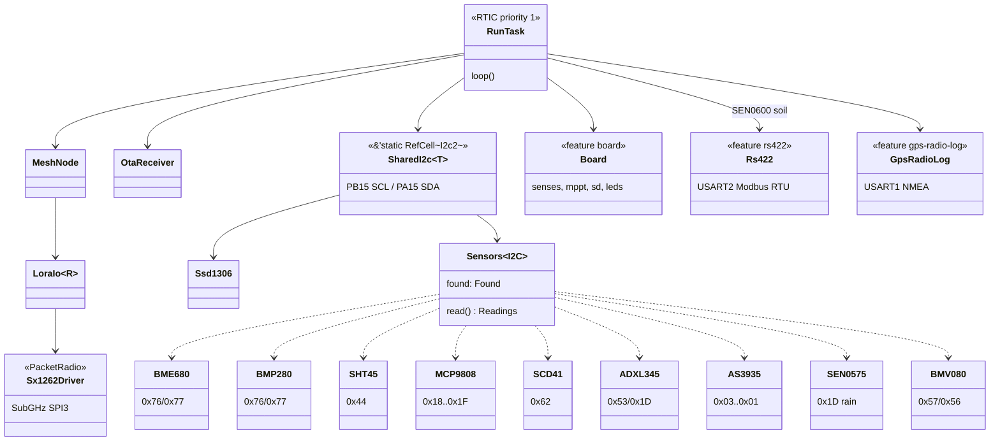

# Architecture

The radio driver implements a `PacketRadio` trait used by the mesh layer.
The driver manages RX/TX state — entering continuous RX on the first poll,
transitioning to standby before TX, then polling the IRQ register for
`TxDone` or `Timeout` rather than blocking on the DIO1 pin.

Everything below hangs off the single priority-1 RTIC task in
`bin/main.rs`; the cfg-gated blocks are cargo features. That single
priority is what makes `SharedI2c`'s `RefCell` sound.

The 0x1D three-way conflict between ADXL345, MCP9808 and SEN0575 is
resolved in probe order — see the SEN0575 section.

## Pin allocation

| Function | Pins | Notes |
|----------|------|-------|
| SWD      | PA13 (SWDIO), PA14 (SWCLK) | Pins 3-4, dedicated |
| I2C2     | PB15 (SCL), PA15 (SDA) | Pins 5-6 |
| UART1    | PB6 (TX), PB7 (RX) | Pins 9-10, gateway serial to Linux box |
| SPI2     | PB13 (SCK), PB14 (MISO), PA10 (MOSI), PB9 (NSS) | Pins 24-27, note PB13 is also boot pin |
| GPIO     | PB4, PB3 | Pins 7-8 |
| RF switch | PA4 (control 1), PA5 (control 2) | Module-internal, not on a pad |

*SPI SCK must remain inactive for boot*
