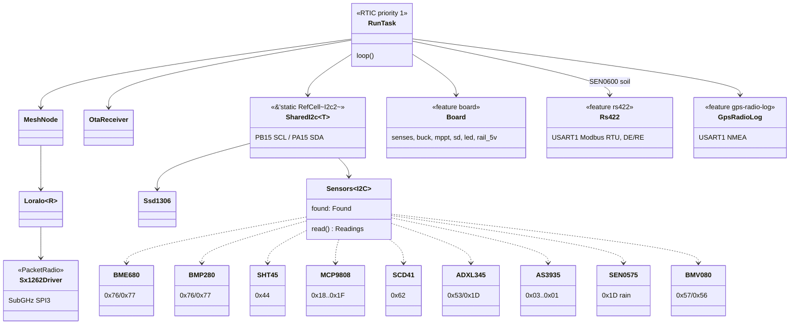

# Architecture

The radio driver implements a `PacketRadio` trait used by the mesh layer.
The driver manages RX/TX state - entering continuous RX on the first poll,
transitioning to standby before TX, then polling the IRQ register for
`TxDone` or `Timeout` rather than blocking on the DIO1 pin.

Everything below hangs off the single priority-1 RTIC task in
`firmware/src/bin/main.rs`; the cfg-gated blocks are cargo features. That single
priority is what makes `SharedI2c`'s `RefCell` sound.

The 0x1D three-way conflict between ADXL345, MCP9808 and SEN0575 is
resolved in probe order - see the SEN0575 section.

## Pin allocation

Wio-E5 on the Forest Sensor Platform V1 board (`board` feature). Pin
numbers are module pads.

| Function | Pins | Notes |
|----------|------|-------|
| SWD      | PA13 (SWDIO), PA14 (SWCLK), RST | Pads 3, 4, 17; shared by the CH572D (CMSIS-DAP) and the J2 header |
| I2C2     | PB15 (SCL), PA15 (SDA) | Pads 5-6, J8 and J10, 4.7k pull-ups |
| SD card  | PB3 (SCK), PB4 (MISO), PB5 (MOSI), PA0 (CS) | SPI1; no card-detect line |
| RS-485   | PB6 (TX), PB7 (RX), PA9 (DE), PB9 (/RE) | USART1 to the TPT482, `rs422` feature |
| Host link | PA2 (TX), PA3 (RX) | USART2 to the CH572D USB bridge; the basestation's link with `board` |
| Senses   | PB13 (VIN), PA10 (VBAT), PB14 (IBAT) | ADC_IN0/6/1, see `firmware/src/board.rs` for scaling |
| Buck PWM | PB10 | TIM2_CH3, high = switch on |
| 5V_EN    | PC0 | Switched 5 V rail (J7 sensor supply, CH572D) |
| LED      | PC1 | D12, active low |
| RF switch | PA4 (control 1), PA5 (control 2) | Module-internal, not on a pad |

## CH572D USB bridge

Its firmware, with a diagram of the modules, is ch572-bridge-rs: see its
[ARCHITECTURE.md](https://github.com/tmpk13/ch572-bridge-rs/blob/main/ARCHITECTURE.md).
