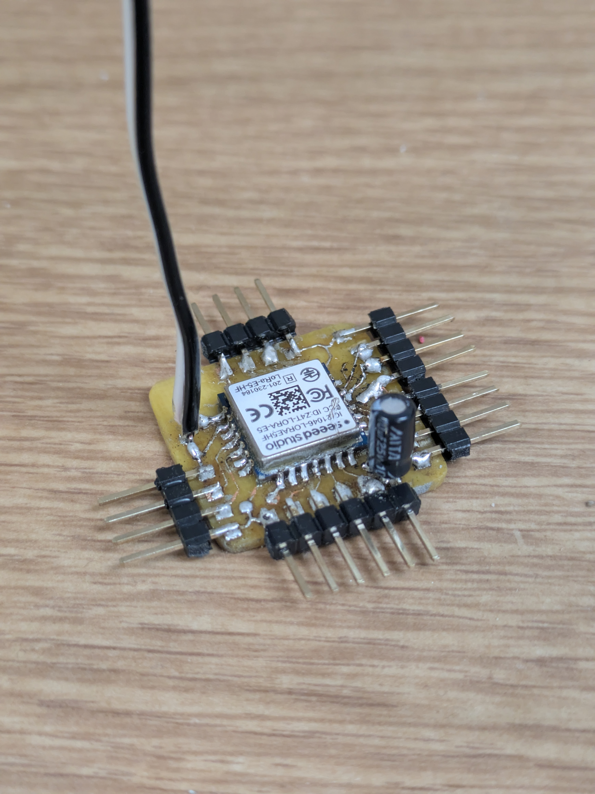
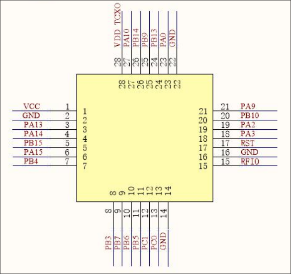

# Hardware

## Forest Sensor Platform V1

The current board: KiCad project
[Forest-Sensor-Platform](https://github.com/tmpk13/Forest-Sensor-Platform)
(main, buck and USB sheets). Wio-E5 pin use is in ARCHITECTURE.md (Pin
allocation), the CH572D's in ch572-bridge-rs
[src/hw.rs](https://github.com/tmpk13/ch572-bridge-rs/blob/main/src/hw.rs),
and the board support in `notes/board.md`. Testing a board:
[v1-board-test.md](v1-board-test.md).

## First prototype board using Seeed Wio-E5

## Wio-E5 pinout

| Pin | Name | Type | Description |
|-----|------|------|-------------|
| 1   | VCC  | -    | Supply voltage for the module |
| 2   | GND  | -    | Ground |
| 3   | PA13 | I    | SWDIO for program download |
| 4   | PA14 | I/O  | SWCLK for program download |
| 5   | PB15 | I/O  | SCL of I2C2 from MCU |
| 6   | PA15 | I/O  | SDA of I2C2 from MCU |
| 7   | PB4  | I/O  | MCU GPIO |
| 8   | PB3  | I/O  | MCU GPIO |
| 9   | PB7  | I/O  | UART1_RX from MCU |
| 10  | PB6  | I/O  | UART1_TX from MCU |
| 11  | PB5  | I/O  | MCU GPIO |
| 12  | PC1  | I/O  | LPUART1_TX from MCU |
| 13  | PC0  | I/O  | LPUART1_RX from MCU |
| 14  | GND  | -    | Ground |
| 15  | RFIO | I/O  | RF input/output |
| 16  | GND  | -    | Ground |
| 17  | RST  | I/O  | Reset trigger input for MCU |
| 18  | PA3  | I/O  | USART2_RX from MCU |
| 19  | PA2  | I/O  | USART2_TX from MCU |
| 20  | PB10 | I/O  | MCU GPIO |
| 21  | PA9  | I/O  | MCU GPIO |
| 22  | GND  | -    | Ground |
| 23  | PA0  | I/O  | MCU GPIO |
| 24  | PB13 | I/O  | SPI2_SCK from MCU; Boot pin (active low) |
| 25  | PB9  | I/O  | SPI2_NSS from MCU |
| 26  | PB14 | I/O  | SPI2_MISO from MCU |
| 27  | PA10 | I/O  | SPI2_MOSI from MCU |
| 28  | PB0  | I/O  | Unavailable; suspended treatment |

