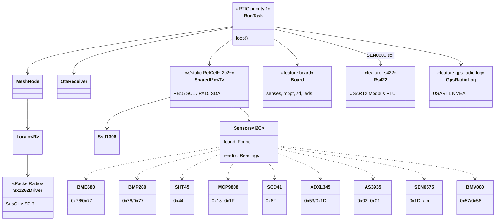

# SX1262 radio

## TX Packet Params Bug

When sending, the packet params must be set with the **actual payload length**
and the **full set of LoRa params** (header type, invert IQ, etc.) to match
init config — not just length and CRC. Omitting fields caused the chip to
enter TX but never fire TxDone, producing a 4s+ spin before timeout.

## Async / Non-Blocking TX

The mesh layer calls `send()` synchronously and blocks until the packet is
acknowledged (retries, ACKs). Making the radio driver non-blocking wouldn't
help because the layer above it still blocks. A proper fix would require:

- Replacing the mesh library with one that supports a poll/yield model, or
- Running the mesh on a dedicated thread/core (ESP32-C3 is single-core, so
  not available here)

The practical fix is keeping the blocking model with a short TX timeout
(~500 ms for SF7/BW125 which completes in <100 ms in practice).

## Seeed XIAO SX1262 Module — TCXO Required

The Seeed XIAO SX1262 module uses a TCXO (temperature-compensated crystal
oscillator) powered via DIO3. If `tcxo_opts` is set to `None` in the sx126x
config, the radio initialises successfully (SPI works, chip enters StbyRC,
no calibration errors) but **can never transmit or receive RF** — the PLL has
no reference clock.

Symptom: every TX times out, `tx_good` stays 0, `rx_good` stays 0.
Fix: configure `tcxo_opts: Some((TcxoVoltage::Volt1_8, TcxoDelay::from_ms(10)))`.

The 1.8 V / 10 ms values are correct for the Seeed module.

## Diagnosing a Dead Radio (all-0xFF SPI responses)

If `get_status()` returns `0b11111111` and all error flags are true, the SX1262
is not responding over SPI at all — MISO is floating high. Common causes:

1. Module not seated — reseat it physically
2. Wrong board flashed (binary for a different address/config)
3. Genuine hardware fault — swap the module between boards to isolate

A healthy init shows `chip_mode: Some(StbyRC)` with all error flags false.

## sx126x Crate: Missing wait_on_busy() — TxDone Never Fires

The sx126x 0.3.0 crate's `set_standby()`, `set_tx()`, and `set_rx()` do **not**
call `wait_on_busy()` internally. The SX1262 datasheet states that any SPI
command sent while BUSY is high is silently ignored by the chip.

Critical path in `send()`:

1. `set_tx()` is issued — the chip starts TCXO startup (10 ms per
   `tcxo_opts`) with BUSY high.
2. Without `wait_on_busy()`, the polling loop immediately calls
   `get_irq_status()` while BUSY is still high.
3. The chip silently ignores those reads; TxDone fires and completes
   inside the BUSY window and is never seen by the poll loop.
4. 150/500 ms software timeout fires; TX appears to have failed.

Symptom: every `send()` times out despite `chip_mode: Some(TX)` appearing in
the debug status; `command_status: None` (RFU/0b001) in the status byte is a
secondary indicator that the chip was still busy when the status was read.

Fix: call `self.radio.wait_on_busy()` after `set_standby()`, after `set_tx()`
(before the IRQ polling loop), and after `set_rx()` wherever it is called.
The same applies to `poll_recv()` — wait after `set_rx()` before reading IRQ.

## Architecture

The radio driver implements a `PacketRadio` trait used by the mesh layer.
The driver manages RX/TX state — entering continuous RX on the first poll,
transitioning to standby before TX, then polling the IRQ register for
`TxDone` or `Timeout` rather than blocking on the DIO1 pin.

Everything below hangs off the single priority-1 RTIC task in
`bin/main.rs`; the cfg-gated blocks are cargo features. That single
priority is what makes `SharedI2c`'s `RefCell` sound.



The 0x1D three-way conflict between ADXL345, MCP9808 and SEN0575 is
resolved in probe order — see the SEN0575 section.

## stm32wlxx-hal SubGhz API Reference (v0.6.1)

### Feature Flags for STM32WLE5JC

```toml
[dependencies]
stm32wlxx-hal = { version = "0.6.1", features = ["stm32wle5", "rt"] }
```

Available chip features: `stm32wl5x_cm0p`, `stm32wl5x_cm4`, `stm32wle5`.
Other useful features: `rt` (runtime), `defmt`, `chrono`, `embedded-time`.

### SubGhz Initialization

```rust
use stm32wlxx_hal::subghz::SubGhz;

// Without DMA (simplest)
let sg = SubGhz::new(dp.SPI3, &mut dp.RCC);

// With DMA
let sg = SubGhz::new_with_dma(dp.SPI3, miso_dma, mosi_dma, &mut dp.RCC);

// After sleep wakeup (unsafe, skips reset)
let sg = unsafe { SubGhz::new_no_reset(dp.SPI3, &mut dp.RCC) };

// Steal without singleton check (unsafe, for RTIC shared resources)
let sg = unsafe { SubGhz::steal() };
```

### Typical LoRa Configuration Sequence

```rust
use stm32wlxx_hal::subghz::*;

// 1. Standby
sg.set_standby(StandbyClk::Rc)?;

// 2. TCXO and calibration (if board has TCXO)
sg.set_tcxo_mode(&TcxoMode::new())?;
sg.calibrate_image(CalibrateImage::ISM_868)?; // or ISM_915

// 3. Regulator
sg.set_regulator_mode(RegMode::Smps)?; // or RegMode::Ldo

// 4. Buffer base addresses
sg.set_buffer_base_address(0, 128)?;

// 5. Packet type
sg.set_packet_type(PacketType::LoRa)?;

// 6. RF frequency
sg.set_rf_frequency(&RfFreq::F915)?; // Constants: F433, F868, F915
// Or custom: RfFreq::from_frequency(915_000_000)

// 7. PA config + TX params
sg.set_pa_config(&PaConfig::HP_22)?;
// HP_22, HP_20, HP_17, HP_14, LP_15, LP_14, LP_10
sg.set_tx_params(&TxParams::HP.set_ramp_time(RampTime::Micros200))?;

// 8. LoRa modulation params
let mod_params = LoRaModParams::new()
    .set_sf(SpreadingFactor::Sf7)    // Sf5..Sf12
    .set_bw(LoRaBandwidth::Bw125)   // Bw7..Bw500
    .set_cr(CodingRate::Cr45)        // Cr45, Cr46, Cr47, Cr48
    .set_ldro_en(false);
sg.set_lora_mod_params(&mod_params)?;

// 9. LoRa packet params
let pkt_params = LoRaPacketParams::new()
    .set_preamble_len(8)
    .set_header_type(HeaderType::Variable) // or Fixed
    .set_payload_len(255)
    .set_crc_en(true)
    .set_invert_iq(false);
sg.set_lora_packet_params(&pkt_params)?;

// 10. Sync word
sg.set_lora_sync_word(LoRaSyncWord::Public)?; // or Private

// 11. IRQ configuration
let irq_cfg = CfgIrq::new()
    .irq_enable_all(Irq::TxDone)
    .irq_enable_all(Irq::RxDone)
    .irq_enable_all(Irq::Timeout)
    .irq_enable_all(Irq::Err);
sg.set_irq_cfg(&irq_cfg)?;
```

### Transmitting

```rust
sg.write_buffer(0, &payload)?;
sg.set_lora_packet_params(
    &pkt_params.set_payload_len(payload.len() as u8)
)?;
sg.set_tx(Timeout::from_millis_sat(5000))?;
// Wait for TxDone IRQ (poll or hardware interrupt)...
let (status, irq_status) = sg.irq_status()?;
sg.clear_irq_status(irq_status)?;
```

### Receiving

```rust
sg.set_rx(Timeout::DISABLED)?; // continuous RX
// Or with timeout:
// sg.set_rx(Timeout::from_millis_sat(10_000))?;

// On RxDone IRQ:
let (status, irq_status) = sg.irq_status()?;
let (status, payload_len, rx_start) = sg.rx_buffer_status()?;
let mut buf = [0u8; 255];
sg.read_buffer(rx_start, &mut buf[..payload_len as usize])?;
sg.clear_irq_status(irq_status)?;

// RSSI / SNR from last packet:
let pkt_status = sg.lora_packet_status()?;
```

### IRQ API

**IRQ variants:** `TxDone`(1), `RxDone`(2), `PreambleDetected`(4),
`SyncDetected`(8), `HeaderValid`(16), `HeaderErr`(32), `Err`(64),
`CadDone`(128), `CadDetected`(256), `Timeout`(512).

**IrqLine variants:** `Global`, `Line1`, `Line2`, `Line3`.
All lines must be enabled for the internal NVIC interrupt to pend.

**CfgIrq builder:**
```rust
CfgIrq::new()
    .irq_enable(IrqLine::Global, Irq::TxDone)  // single line
    .irq_enable_all(Irq::RxDone)                // all lines
    .irq_disable_all(Irq::HeaderErr)            // disable on all
```

**NVIC helpers:**
- `subghz::unmask_irq()` — unmask SubGHz IRQ in NVIC (unsafe)
- `subghz::mask_irq()` — mask SubGHz IRQ in NVIC
- `subghz::rfbusys()` / `rfbusyms()` — check radio busy
- `subghz::wakeup()` — wake from sleep (unsafe)

### RTIC Integration Notes

The stm32wlxx-hal repo has **no RTIC examples**. The testsuite has
`subghz.rs` for on-target TX/RX tests (requires two nucleo boards).

For RTIC, bind the `SUBGHZ_RADIO` interrupt to a hardware task and use
`SubGhz::steal()` or pass via shared resources. The interrupt name in the
PAC is `SUBGHZ_RADIO`.

### Key Status Methods

- `sg.status()` — radio state (has documented HW bugs)
- `sg.irq_status()` -> `(Status, u16)` — IRQ flags
- `sg.rx_buffer_status()` -> `(Status, payload_len, buffer_ptr)`
- `sg.lora_packet_status()` -> `LoRaPacketStatus` (RSSI, SNR)
- `sg.rssi_inst()` -> instantaneous RSSI in dBm
- `sg.op_error()` -> operational error flags
- `sg.fsk_packet_status()`, `sg.fsk_stats()`, `sg.lora_stats()`
- `sg.reset_stats()` — clear cumulative stats

### Other Useful Methods

- `sg.set_sleep(SleepCfg)` — enter sleep (unsafe, 500us NSS hold-off)
- `sg.set_fs()` — frequency synthesis test mode
- `sg.set_rx_duty_cycle(rx_period, sleep_period)` — duty-cycled RX
- `sg.set_cad()` / `sg.set_cad_params(&CadParams)` — channel activity detection
- `sg.set_tx_rx_fallback_mode(FallbackMode)` — auto-mode after TX/RX
- `sg.set_pa_ocp(Ocp)` — over-current protection
- `sg.set_rx_gain(PMode)` — RX gain control
- `sg.free()` -> `(SPI3, MISO, MOSI)` — return peripherals


---

## LoRa range presets via LORA_PRESET build flag

SF/BW/CR are now build-time selectable via the LORA_PRESET env var
(fast/long/max/extreme), same option_env! pattern as ADDRESS. Selection
lives in config.rs (RadioPreset enum + RADIO_PRESET const); radio.rs
init() matches on it for set_lora_mod_params. TX power stays +22 dBm on
all presets - only modulation changes.

Key gotchas baked in:
- Airtime grows ~2^SF (SF7 ~0.1 s -> SF12 ~3.3 s for a 40 B packet), so
  TX_POLL/CHIP_TIMEOUT and MESH_LISTEN_PERIOD are derived per-preset in
  config.rs. Leaving them at the SF7 values would make every TX time out
  before TxDone fires.
- LDRO must be enabled for symbol time > 16.38 ms (SF11/SF12 @ BW125,
  SF12 @ BW62.5); the preset match sets ldro accordingly.
- Invalid LORA_PRESET values panic at compile time (const match).
- max/extreme exceed the FCC 400 ms dwell limit for 902-928; extreme
  relies on the Wio-E5 TCXO for the narrow 62.5 kHz bandwidth.

Confirmed +22 dBm is genuinely max: PaConfig(duty=0x04,hp_max=0x07,Hp) +
set_power(0x16) exactly match the HAL's PaConfig::HP_22 / TxParams::HP
presets; OCP at Max140m (140 mA) is required for the HP PA or output
would be clamped below +22.

## RxBoost via the RX_BOOST build flag

The SX126x RxGain register was never written, so the radio ran at its
power-up default of power-saving gain. Boosting it is worth ~2 dB of
sensitivity - about one step of `LORA_PRESET` - for no airtime at all,
which is the cheapest link budget available here.

Exposed as `RX_BOOST=0|1` alongside `LORA_PRESET` and `ADDRESS` rather than
as a preset field: it is orthogonal to the modulation, and unlike the
presets it does not have to match at both ends. Defaults to off to match the
chip, because the cost is receive current drawn continuously on a node that
listens most of the time - a real trade on solar, so it is opted into rather
than inherited. A bool rather than the HAL's four-level `PMode`: only power
saving and boosted have specified behavior.

Applied inside `init` on every call rather than once, because RxGain is not
covered by warm-start sleep retention. Moot today - the only path back is a
full re-init - but it keeps the setting correct if the radio is ever put
into a retaining sleep.
